# Home page "story hero": plan

**Date:** 17 Nov 2026 · **Status:** **Phase A (blockout) is built** and live on the home page behind the normal tier rules; Phases B–E are not started. See [Phase A status](#phase-a-status) just below the contents. Decisions D8 and D9 are settled (§13).
**Relates to:** [WOW_EFFECTS_PLAN.md](WOW_EFFECTS_PLAN.md) (motion rules §4, tiers), [DESIGN_IMPROVEMENT_PLAN.md](DESIGN_IMPROVEMENT_PLAN.md) §6 (home sections), §8 (motion system).

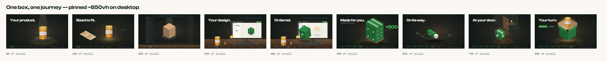

> The pictures in §4 are **storyboard sketches**: flat drawings to show the scenes, camera and timing. The real section is built in live 3D with the same renderer as today's hero box (§5.1), so it will look like a physical box under studio light, not like these drawings.

---

## Contents

1. [The idea in one minute](#1-the-idea-in-one-minute)
2. [What was asked, and how this plan answers it](#2-what-was-asked-and-how-this-plan-answers-it)
3. [Where it goes on the home page](#3-where-it-goes-on-the-home-page)
4. [The story, scene by scene](#4-the-story-scene-by-scene)
5. [Look and feel](#5-look-and-feel)
6. [How it is built](#6-how-it-is-built)
7. [Phones, slow devices and reduced motion](#7-phones-slow-devices-and-reduced-motion)
8. [Performance budget](#8-performance-budget)
9. [Accessibility, SEO and analytics](#9-accessibility-seo-and-analytics)
10. [Phases and effort](#10-phases-and-effort)
11. [Risks](#11-risks)
12. [References (with screenshots)](#12-references)
13. [Decisions needed from the owner](#13-decisions-needed-from-the-owner)

---

## Phase A status

**Built 17 Nov 2026:** the whole 9-scene story as grey shapes with the final timing, camera path, words, rail and buttons, so the story and pacing can be judged before any detailed art. It sits on the home page right after Industries.

| Scene | Phase A shows |
|---|---|
| 1 Product | 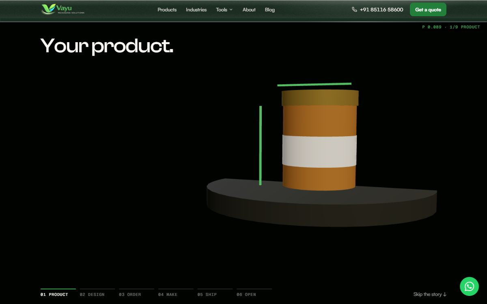 |
| 2 Fit | 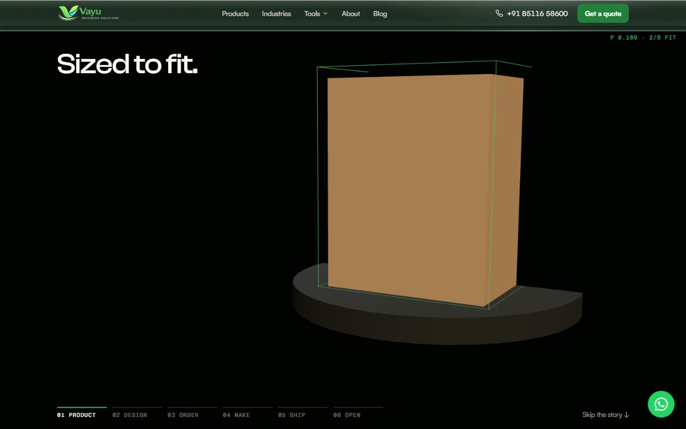 |
| 3a Reveal | 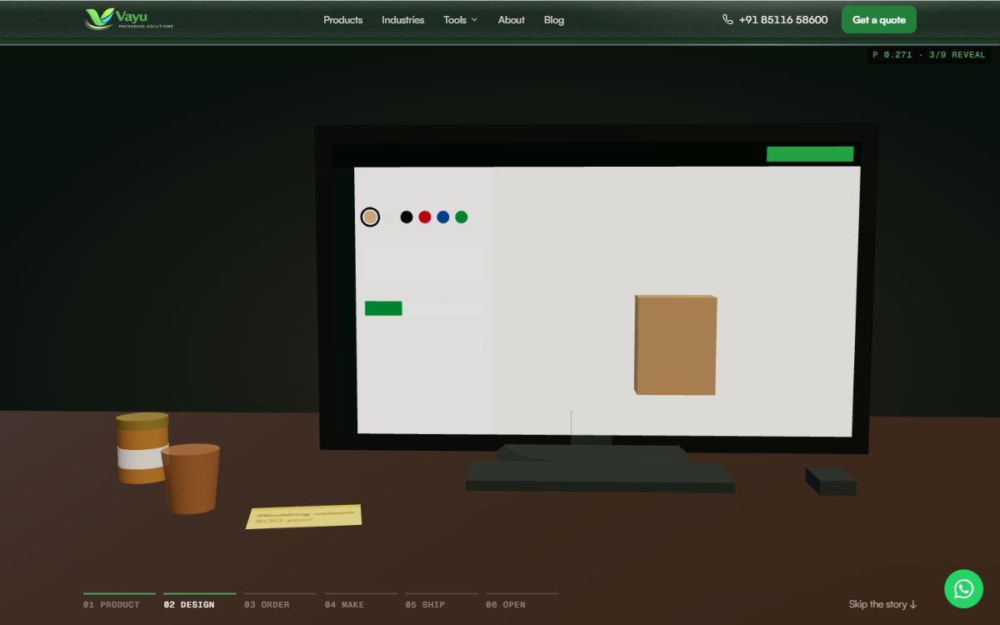 |
| 3b Design | 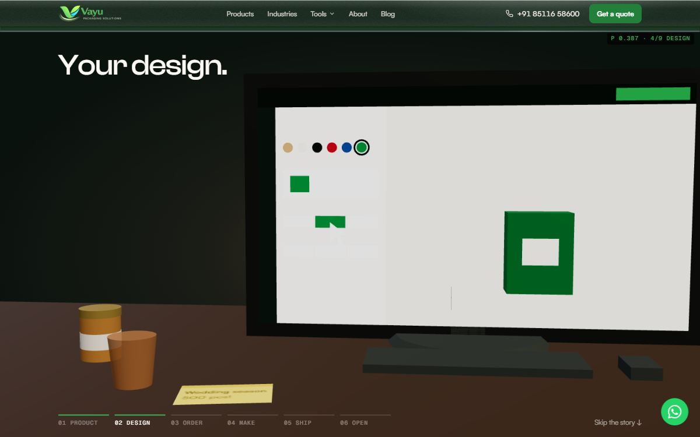 |
| 3c Order | 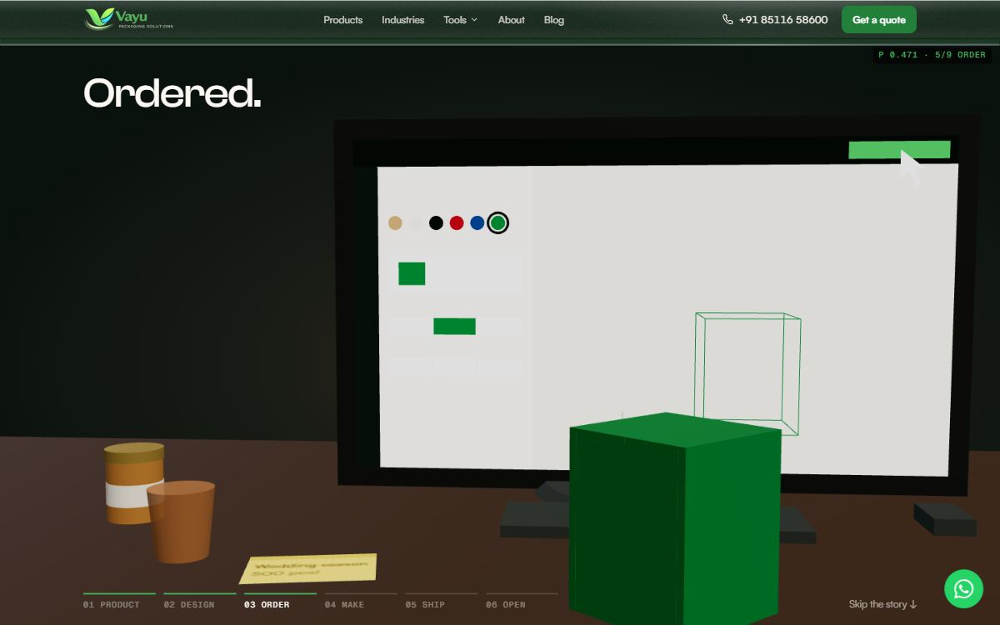 |
| 4 Make | 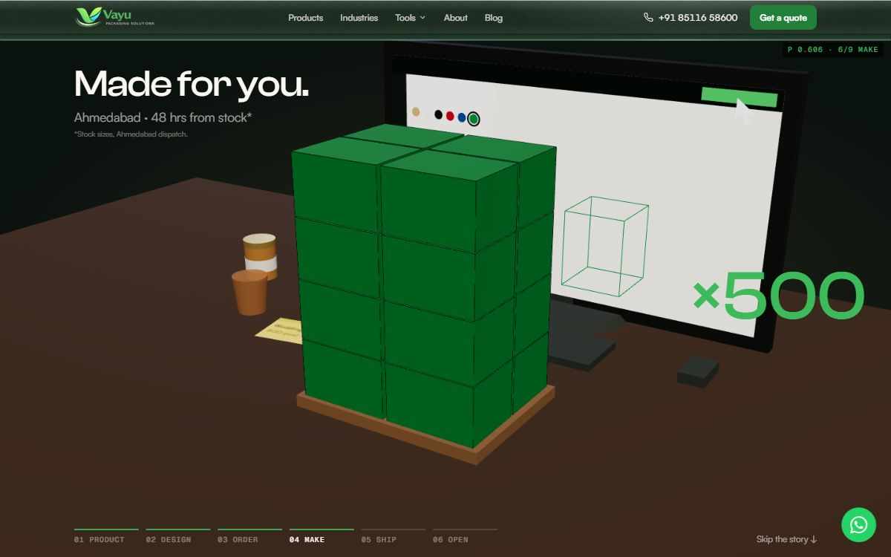 |
| 5 Ship | 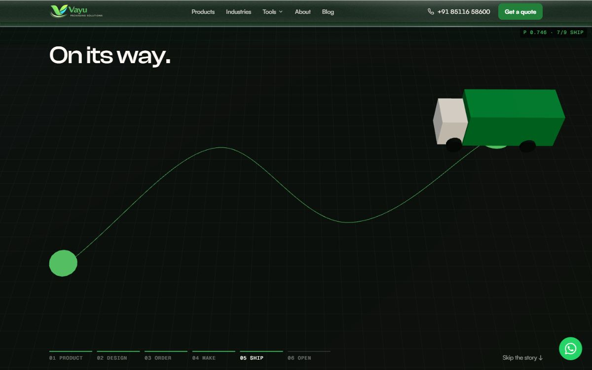 |
| 6 Door | 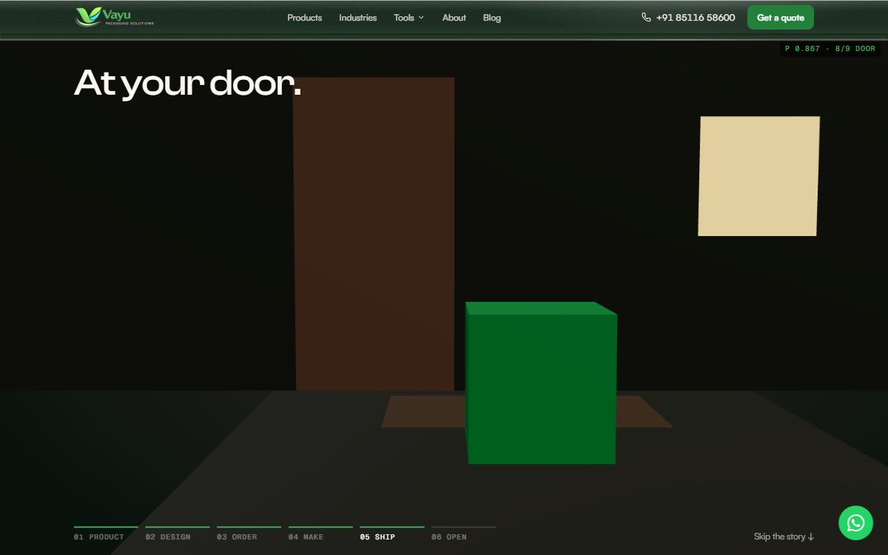 |
| 7 Open | 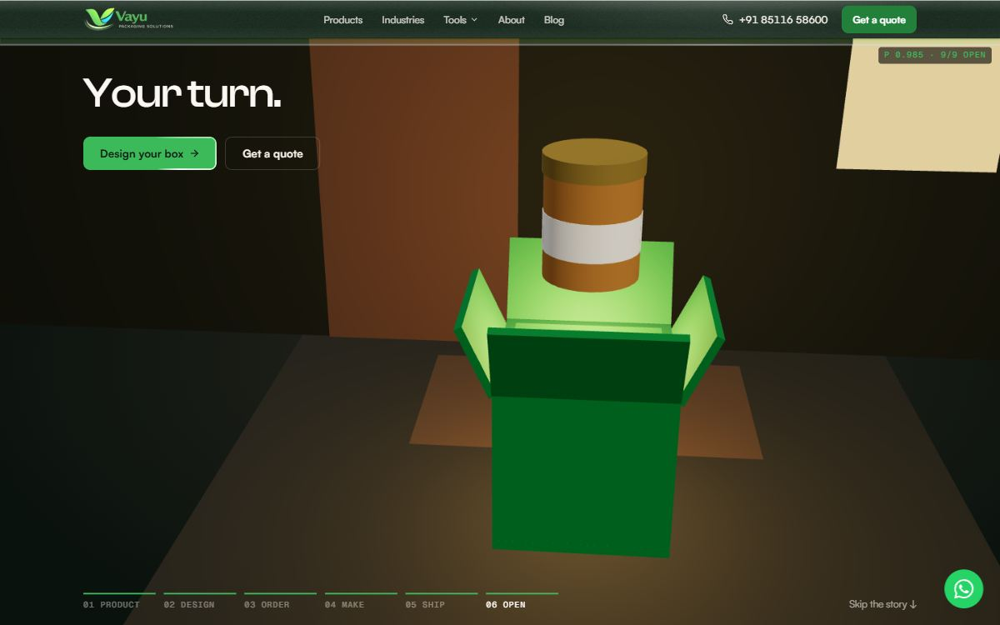 |

Phone "stories" mode (autoplay, tap to step): 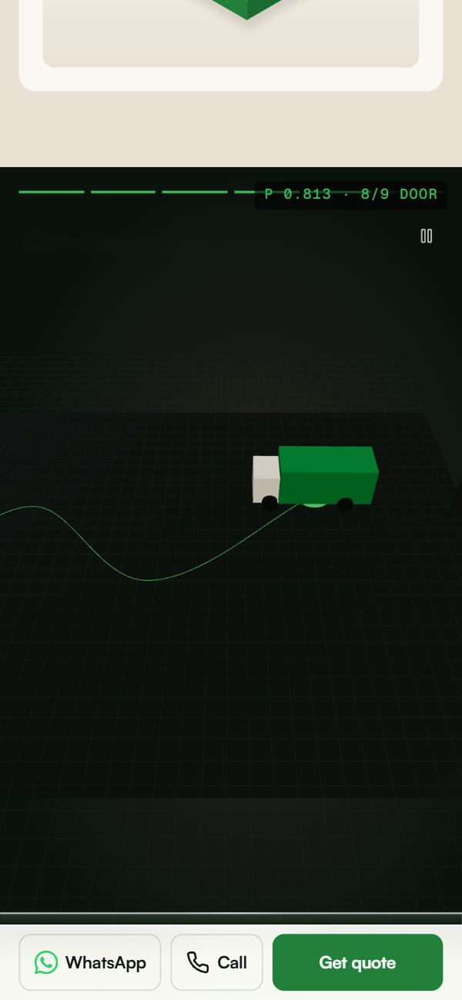 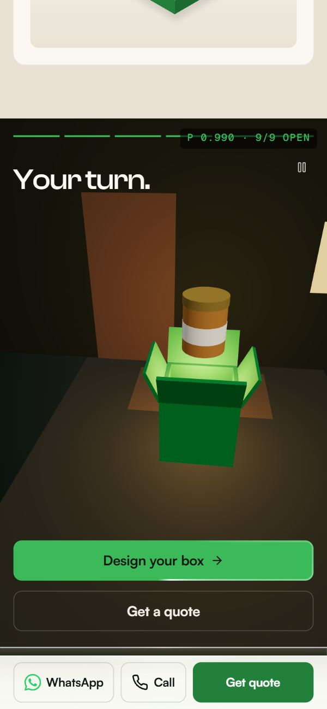

**What works already:** sticky scroll with smoothing; the scene words; the clickable rail; the scripted cursor that picks colour, logo and board and clicks "Quote this design"; the box stepping out of the screen; the pallet filling with a rolling ×500; the route drawing with the truck; the doorstep drop with a bounce; the flaps opening with the glow and the jar rising; the two buttons; the phone autoplay with pause and tap; the still-card fallback; the seasonal sticky note (D9); analytics events; a `?story-debug` label.

**Deliberately still blockout (later phases):** all materials and lighting (B), the monitor as a real `RenderTexture` with text, the chai steam and a seamless reveal (B2), the map outline of India, tape and stretch film (C), the stills for the fallback (D), post-processing (E). The stage backdrop shrinking onto the monitor is a stand-in for the seamless pull-back.

**Try it:** run the site and open `/?quality=high&story-debug=1` (the quality flag is needed because software renderers are tiered "low"). Screenshots of every scene: `node scripts/screenshots/qa.mjs scripts/screenshots/jobs/story-beats.mjs`.

**Findings while building:**
- The sticky-track approach (§6.5) replaced the planned GSAP pin: no layout shift after load, no pin-spacer re-measure, and the smoothing is a few lines. The story does not use GSAP at all.
- The lazy 3D chunk is **4.7 KB gzipped** (three and R3F are shared with the top hero), well under the 60 KB budget.
- The desk objects physically overlap the spotlight scene because that scene sits right behind the monitor glass. Phase B2 fixes this properly (the spotlight scene renders into the screen texture); until then the stand and keyboard are held back until the screen swaps.
- Open items for Phase B: framing the door scene properly (the window is a flat placeholder), and re-checking every camera pose once real materials change the look.

---

## 1. The idea in one minute

**"One box, one journey."** A cinematic section in the middle of the home page. As the visitor scrolls, **one real-looking box** lives through the customer's whole story:

| | Scene | What the visitor sees | Word on screen |
|---|---|---|---|
| 1 | Product | Their product under a spotlight, measured by lines that draw themselves | *Your product.* |
| 2 | Fit | A flat box blank slides in and folds up around it | *Sized to fit.* |
| 3a | Reveal | The camera pulls back: the spotlight scene was **on a computer monitor** all along. A desk appears | — |
| 3b | Design | On the monitor, **someone is designing the box in our 3D designer**: the cursor picks colour, logo and board, and the mouse on the desk moves with it | *Your design.* |
| 3c | Order | The cursor clicks **"Quote this design"**, and the box **pushes out of the screen** onto the desk | *Ordered.* |
| 4 | Make | The camera pulls back: one box becomes a taped pallet, the counter rolls to ×500 | *Made for you.* |
| 5 | Ship | A truck carries it along a route from Ahmedabad to "your city" | *On its way.* |
| 6 | Door | The box lands on a doorstep in warm evening light | *At your door.* |
| 7 | Open | The flaps open, light spills out, the product rises: the unboxing | *Your turn.* + 2 buttons |

- **Words in the whole section: about 20**, one short phrase per scene plus two buttons. Everything else is picture and motion.
- **The design moment is a person at a desk using our tool** (scenes 3a–3c, updated 17 Nov 2026 at the owner's request). No person is drawn. Their presence is shown by the moving mouse, a glass of chai and a "Diwali order" sticky note. The screen shows a **live miniature of the real designer**, not a screenshot.
- **Visual: real-time 3D.** It reuses the Box Designer's own carton engine (`BoxRig`), so the box folds, prints and opens exactly as it does in our tool. The section is also an honest demo of the tool.
- **Emotion:** the story is told in the second person ("your product", "your design", "your door") and ends on the unboxing moment, the moment a customer actually feels.
- **No new runtime libraries.** three.js, React Three Fiber, drei, postprocessing, GSAP and framer-motion are already installed and already used on the site.

---

## 2. What was asked, and how this plan answers it

| Owner's request (17 Nov 2026) | Answer in this plan |
|---|---|
| A "best ever" hero, but **in the middle** of the page, not at the top | The top hero stays as it is. The story section goes after "Industries" (§3) |
| **Graphics of real objects**, not text content | Live 3D: the real carton engine, a glass jar, a pallet, a truck and a doorstep, with studio light, soft shadows and paper grain (§5, §6) |
| Tell the story: **product → designing on our tool → ordering → delivery** | 9 scenes in 6 chapters: Product, Design, Order, Make, Ship, Open (§4) |
| *(follow-up)* In the design stage, show **someone at a desktop designing the box with our tool** | Scenes 3a–3c: the camera reveals a desk and monitor running a live mini version of our designer; clicking "Quote this design" sends the box out of the screen (§4) |
| Hit the **viewer's emotions** | Second-person words, a slow spotlight opening, the build-up of 500 boxes, and an unboxing ending with warm light (§5.3) |
| **95% visuals, very little text** | About 20 words in a full-screen section. No paragraphs, no cards, no screenshots of our UI (the house rule for showcase pages) |
| References from top sites, with screenshots | §12: 6 captured screenshots and about 30 checked links, with the top 8 marked |
| Which library | §6.2 |

---

## 3. Where it goes on the home page

The current order (from [Home.tsx](../../src/pages/Home.tsx)):

```
S1  The Fold (hero, 3D box)          ← stays as the first screen
S2  Trust bar
S3  Inside the board
S4  Range
S5  Industries  "Built for what you ship."
──────────────────────────────────────────
★   STORY: "One box, one journey"     ← NEW, the middle of the page
──────────────────────────────────────────
S6  Dieline to dispatch (stacking cards)
S7  Order your way
S8  Proof
S9  Talk to us
```

**Why after Industries:** Industries ends on *"Built for what you ship."* and the story opens on *"Your product."*. The handover reads like one sentence. By this point the visitor knows what Vayu makes and for whom. The story turns that into a feeling just before the practical sections (process, ordering, contact).

**Overlap to note:** the story's "Make / Ship" scenes cover some of what S6 *Dieline to dispatch* and the order timeline in S7 say. The story is the feeling and S6/S7 are the details for people who want them. After the story ships, S6/S7 could be trimmed to cut text further. That is decision **D4** in §13; it is not part of this plan.

**Current page for comparison:** most sections lead with a heading and text blocks.

| Top hero today (stays) | A typical mid-page section today |
|---|---|
| 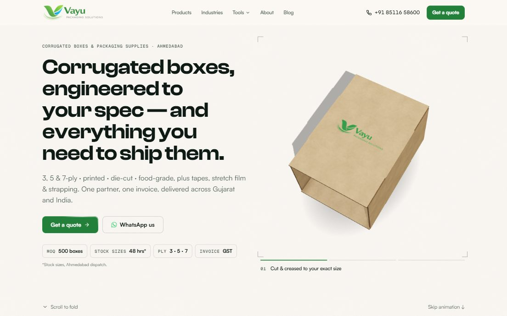 | 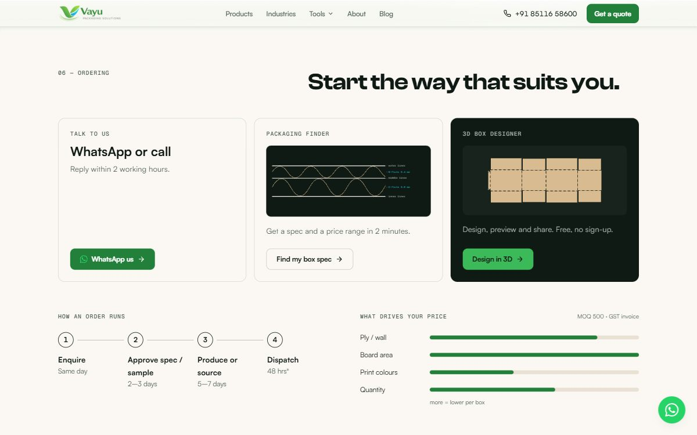 |

The box in the left screenshot is the live `BoxRig` render. **That is the render quality the story uses**, not the flat drawing style of the storyboard.

---

## 4. The story, scene by scene

On desktop the section is **pinned for about 650vh of scroll**: the visitor scrolls normally, and the stage stays on screen while the scenes play. Scroll % below is the share of that pinned distance. The progress rail at the bottom (Product · Design · Order · Make · Ship · Open) shows where you are, and each label can be clicked to jump to it.

**Storyboard key:** white words are what visitors will read; **cyan text and arrows are notes for this plan only** (camera moves, explanations) and never appear on the site.

### Scene 1: "Your product." (0–10%)

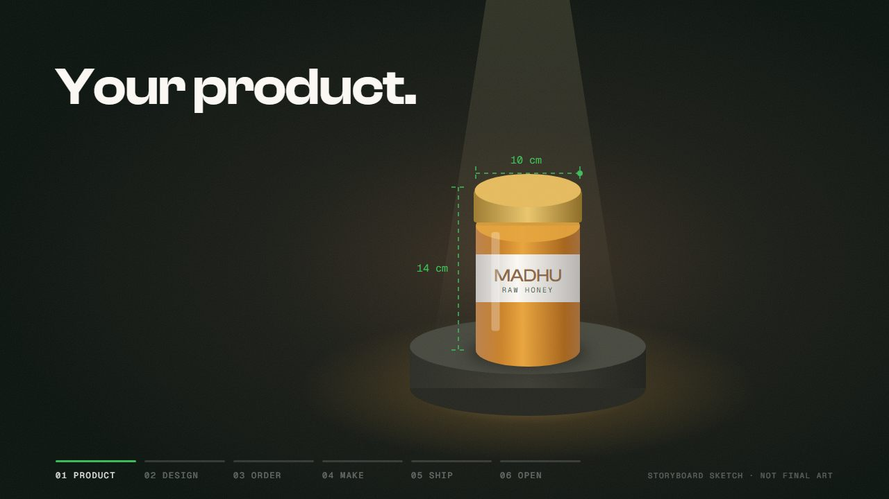

- **Visual:** the section opens dark. A warm spotlight fades up on a plinth, and a glass jar (honey, with a paper label) settles onto it with a tiny bounce and turns slowly.
- **Motion:** dashed measuring lines draw themselves along height and width, and the numbers roll up in mono type (*14 cm*, *10 cm*).
- **Feeling:** "this is about *my* thing." The spotlight is a theatre opening.
- **Built with:** a jar made in code (`LatheGeometry`, glass + honey material, label drawn on a canvas texture); drei `<Line dashed>` with an animated dash offset; drei `<SpotLight>` cone.

### Scene 2: "Sized to fit." (10–20%)

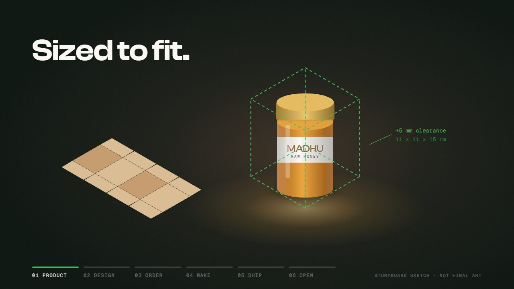

- **Visual:** a dashed green box outline appears around the jar, with *+5 mm clearance* beside it. A flat kraft **box blank** (the real dieline shape, with creases) slides in on the floor and **folds up** around the jar: walls rise, flaps close and the jar disappears inside.
- **Motion:** the fold is the designer's own fold animation (`setPose` from flat to sealed), driven by scroll.
- **Feeling:** precision. "They make it fit *my* product."
- **Built with:** `BoxRig` + `computeRscLayout` (the same as the top hero). The clearance numbers come from `recommendInsideSize()` in [fit.ts](../../src/lib/boxDesigner/fit.ts), so they are real.

### Scene 3: the desk, in three moves (20–48%)

This is the heart of the story: **someone at their desk, designing the box in our tool, then ordering it.** It is told as one unbroken camera move.

#### 3a. Reveal (20–28%)

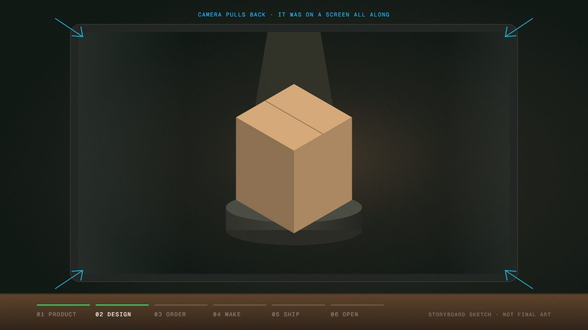

- **Visual:** the camera slowly **pulls back** from the sealed box on the plinth, and the visitor realises it was **on a computer monitor all along**. The monitor bezel slides into view, then a wooden desk.
- **Feeling:** a small "oh!" moment. The film turns into *someone's real working day*.
- **Built with:** scenes 1–2 render into the monitor's screen texture (drei `RenderTexture`), and the camera starts framed exactly on the screen so the hand-off is invisible. Medium tier: a quick cross-fade instead of the seamless pull-back.

#### 3b. "Your design." (28–40%)

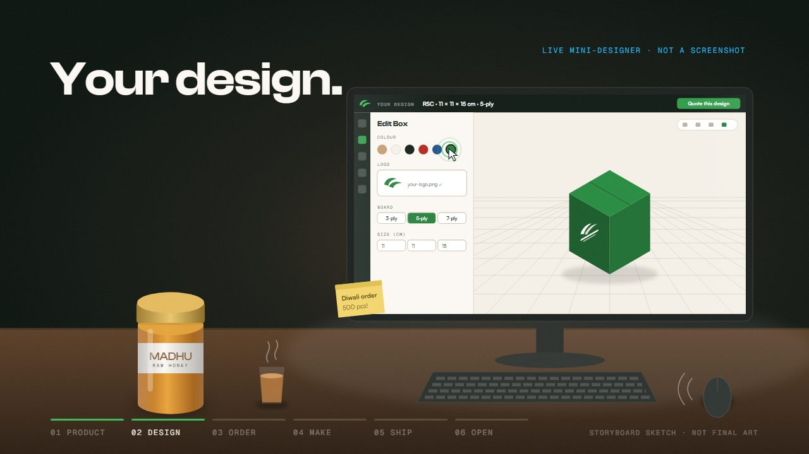

- **Visual:** a real-feeling desk in warm evening light: the monitor, a keyboard, a mouse, a small glass of **cutting chai** with steam, a yellow sticky note (*"Diwali order, 500 pcs!"*), and the customer's **honey jar** standing beside the screen. That is the product from scene 1, so the visitor sees *who* this box is for.
- **On the screen:** a **live miniature of our real Box Designer** with the same layout visitors get at `/box-designer`: the dark top bar with the spec (*RSC · 11 × 11 × 15 cm · 5-ply*) and the green **Quote this design** button, the icon rail, the cream **Edit Box** panel, and the grid canvas with the box. The cursor clicks through **colour → logo → 5-ply**, and the 3D box on screen changes with each click: kraft → white → brand colour, then the logo stamps on.
- **The person is felt, not shown:** the **mouse on the desk moves in step with the cursor**, the chai steams, the sticky note says what the order is for. No human figure is drawn (image policy: no AI people; a stock photo would feel fake). See decision **D8**.
- **Feeling:** "That could be me at my desk tonight. And it looks easy." This scene sells the free 3D designer without a sentence about it.
- **Built with:**
  - Desk, monitor, keyboard, mouse, chai glass and sticky note as **code-built objects** (drei `RoundedBox`, lathe shapes, the site's paper and wood materials). Nothing to download.
  - The screen is a drei **`RenderTexture`** on the monitor's screen mesh. Inside it, a second small `BoxRig` shows the live box, and the UI chrome (top bar, rail, panel, swatches, buttons) is drawn on a `CanvasTexture` with the site fonts. It is **redrawn only when something changes** (a click), not every frame.
  - The panel layout and swatch colours come from the same sources as the real designer (`BOX_COLOR_OPTIONS`, board specs), so the miniature stays honest when the tool changes.
  - The cursor path is keyframed in `beats.ts`; the desk mouse copies the cursor's movement at a smaller scale.
- **This is not a screenshot of our UI** (the house rule against UI screenshots still holds). It is a live, simplified rendering of the tool that updates in the scene.

#### 3c. "Ordered." (40–48%)

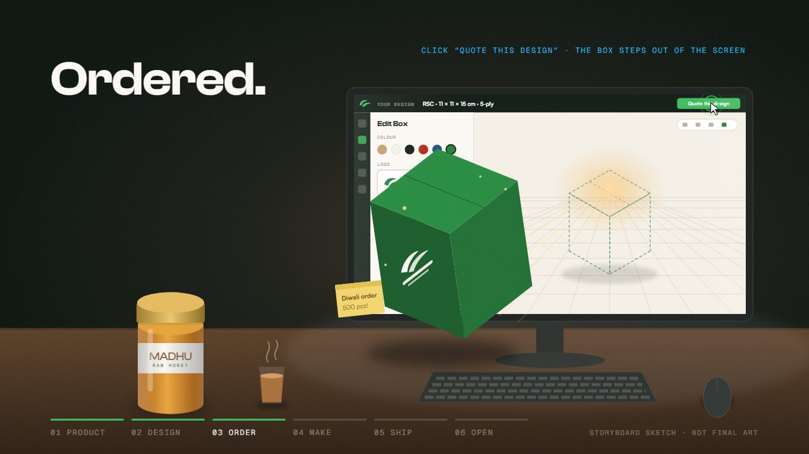

- **Visual:** the cursor moves to **Quote this design** and clicks. The box on screen turns into a dashed outline, and the **real box pushes out through the screen**: it breaks the glass plane with a burst of warm light and a few sparks, tumbles slightly and lands on the desk next to the jar.
- **Feeling:** the "designed → real" moment (the Vizcom idea in §12). This is the **ordering** step of the owner's story, shown as one click.
- **Built with:** at the click, the screen's box hides and the main-scene `BoxRig` appears at the screen's position, then moves out on a short arc with a spring landing. Light burst: one point light + bloom on the high tier. Then the camera rises and pulls back into scene 4.
- **Personal touch (Phase F, optional):** if the visitor already saved a design in our 3D designer on this browser (`listDesigns()` in [myDesigns.ts](../../src/lib/boxDesigner/myDesigns.ts)), scenes 3b–3c use **their** colours and logo. "Your design." then becomes literally true.

### Scene 4: "Made for you." (48–62%)

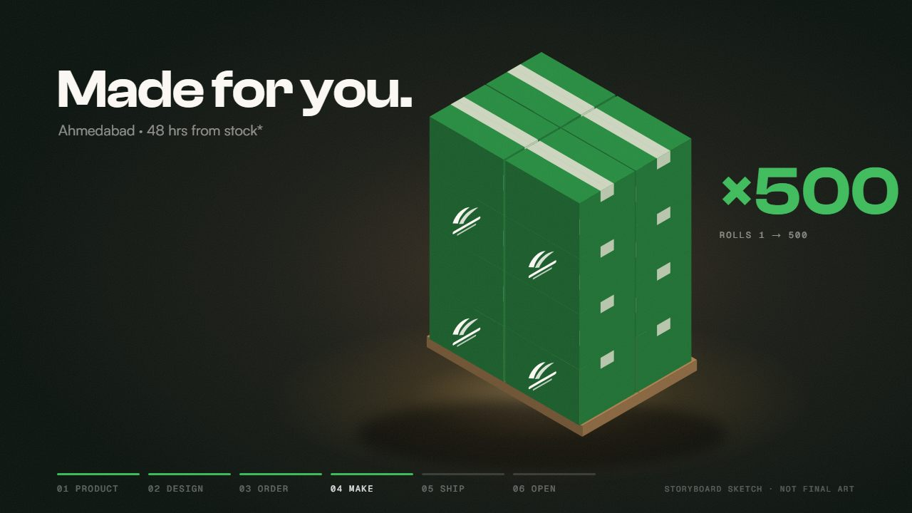

- **Visual:** the camera cranes up and back from the desk, and the box that just landed **multiplies**: copies drop in row by row onto a wooden pallet, and tape strips run across the tops. A big **×500** rolls up from 1 (MOQ from `FACTS.moqBoxes`). A thin line under the word: *Ahmedabad · 48 hrs from stock\**.
- **Feeling:** scale and trust. "A real factory makes my boxes."
- **Built with:** `InstancedMesh` (one draw call for every copy), spring drop timing, `RollingNumber` from `components/fx`. Optional later: stretch film wrapping the pallet.

### Scene 5: "On its way." (62–76%)

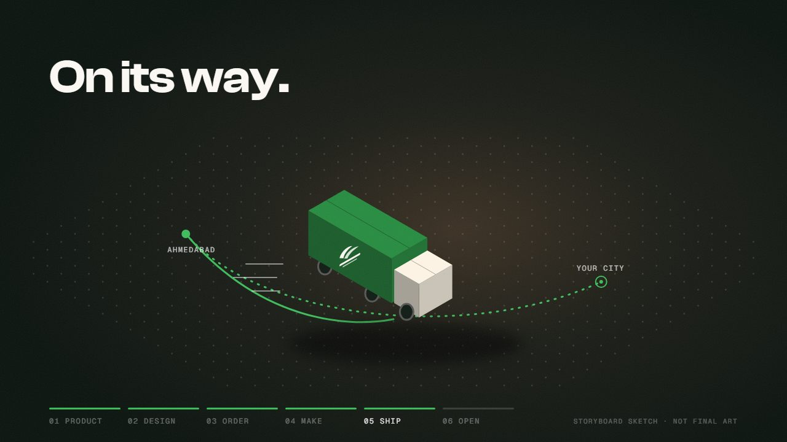

- **Visual:** the floor becomes a dotted map. A route **draws itself** from **Ahmedabad** to **Your city**, and a small truck in Vayu colours rolls along it. Speed lines, and the light shifts toward golden hour.
- **Feeling:** movement and anticipation: "it's coming to me."
- **Built with:** a code-built truck (rounded boxes in the same materials, so there is no model to download); the route as a `CatmullRomCurve3` with the truck at `getPointAt(t)`; India's outline from **Natural Earth** (public domain), simplified to a few KB.
- **Note:** "Your city" stays generic. We do **not** ask for location. VERIFY-LATER[STORY-02]: confirm the delivery-coverage claim the map implies ("across India") matches `FACTS`.

### Scene 6: "At your door." (76–88%)

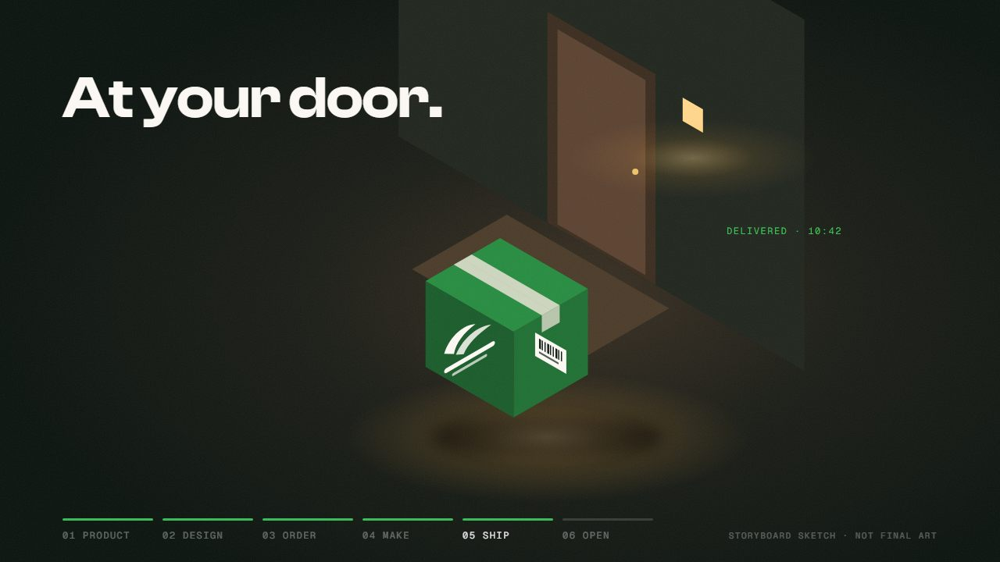

- **Visual:** a doorstep at dusk: wall, door, a lit window and a WELCOME mat. The box drops in with a soft thud (tiny camera dip, a puff of dust) and sits there with its tape and shipping label. A small mono tag: *DELIVERED · 10:42*.
- **Feeling:** the "it's here!" moment everyone knows from online orders.
- **Built with:** primitives and the same paper and kraft materials, warm point light, a few dust sprites.

### Scene 7: "Your turn." (88–100%)

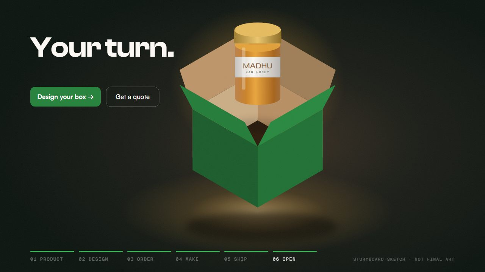

- **Visual:** the flaps swing open, **warm light spills out of the box** (a soft bloom), and the jar rises gently out of it: the unboxing. The words *Your turn.* and two buttons appear: **Design your box →** (to `/3d-box-designer`) and **Get a quote**.
- **Feeling:** delight, then action. The story ends with the visitor holding the pen.
- **Built with:** `BoxRig.setPose()` back to the open-top stop (`FOLD_STOPS.openTop`), a point light inside the box, `Bloom` on the high tier only.

### Timing at a glance

| Scene | Scroll range | Camera | Main motion |
|---|---|---|---|
| 1 Product | 0–10% | close, low, slight depth of field | spotlight up, measure lines draw |
| 2 Fit | 10–20% | three-quarter view | blank slides in, folds around jar |
| 3a Reveal | 20–28% | pull back from the screen to the desk | the film was on a monitor |
| 3b Design | 28–40% | over-the-desk, eye level | cursor clicks colour → logo → 5-ply; desk mouse moves with it |
| 3c Order | 40–48% | slight push toward the screen | "Quote this design" click, box steps out of the screen |
| 4 Make | 48–62% | crane up and back | instances drop, ×500 rolls |
| 5 Ship | 62–76% | high, map view | route draws, truck travels |
| 6 Door | 76–88% | eye level, dusk | box lands, dust puff |
| 7 Open | 88–100% | close, top three-quarter | flaps open, glow, jar rises, CTA |

Each scene **holds still for about 20% of its range**, so the visitor can stop scrolling and look. Motion never stops halfway at a scroll position.

---

## 5. Look and feel

### 5.1 Real objects, not drawings

The storyboard is flat on purpose, because it is quick to change. The built section gets its "real object" look from:

- **The real carton engine**: mitred corners, flute edges, paper grain and fibre normal maps (`enableSurfaceDetail()`), print that stays continuous across folds. It is already in production in the top hero.
- **Studio lighting without a download**: the existing `StudioEnvironment` (light panels, `Lightformer`) instead of an HDRI file, plus one warm key light per scene.
- **Grounding**: soft contact shadows under every object (drei `ContactShadows`, refreshed only while something moves).
- **Materials**: honey glass (`MeshPhysicalMaterial`: clearcoat, a warm amber attenuation colour, transmission on the high tier only), brushed metal lid, kraft with grain, wood pallet.
- **Film touches** (high tier): light bloom from the open box, a soft vignette, a little depth of field in scene 1, and the site's existing grain overlay.

### 5.2 Stage colour

A **dark "theatre" stage** (`ink-950`, with a warm kraft spotlight) in the middle of the cream page. The contrast tells the visitor *something different starts here*, and warm light on a dark stage is what makes it feel emotional. The section fades in from and out to the cream sections around it. Option: a cream stage (decision **D2**).

### 5.3 Emotional beats (why it should "hit")

1. **Recognition**: it starts with *their* product, not with our factory.
2. **Agency**: *they* design it, at a desk like theirs (chai, sticky note, a festival order), so the cursor is theirs.
3. **Scale and trust**: 500 real boxes, a real city, real hours.
4. **Anticipation**: the route, the truck, the dusk light.
5. **Reward**: the unboxing glow. The CTA comes at this peak, not after it.

### 5.4 Text budget (hard rule)

- At most **one phrase of 3 words or fewer per scene**, in `font-display`, using the existing `SplitWords` blur-in.
- Micro-labels (*14 cm*, *×500*, *AHMEDABAD*) only where they are part of the picture.
- **No paragraphs, no cards, no bullet lists** inside the section. Screen-reader text is separate (§9).

---

## 6. How it is built

### 6.1 Approach options (and the pick)

| Option | Looks | Weight | Changeable later | Phone | Verdict |
|---|---|---|---|---|---|
| **A. Real-time 3D (R3F), reusing `BoxRig`** | Very good; the same as our hero | Small: code plus a few KB of data, no models | Yes. Colours, product, words and the visitor's own design (scene 3) | Good on medium/high tier | **Chosen** |
| B. Pre-rendered image sequence (Blender → WebP, Apple style) | Best (path-traced) | 3–6 MB desktop, 1–2 MB phone (§12.3) | No. Every change means a re-render | Heavy | Fallback only, for one scene if needed |
| C. Scroll-scrubbed video | Good | Heavy | No | Stutters on phones (OPTIKKA write-up, §12) | Not used |
| D. SVG / Lottie illustration | Flat | Tiny | Yes | Great | Used only for the low-tier stills (§7) |
| E. Spline scene | Good | +0.5 MB runtime before the scene file | In Spline only | Medium | Not used; fine for quick sketching |

**Why A:** the visitor sees *our actual tool's box* in the story, so the story doubles as a product demo. It is light, it can be personalised, and 80% of the hard part (folding, print, grain) already exists and is tested.

### 6.2 Libraries

| Library | Already installed? | Used for |
|---|---|---|
| `three`, `@react-three/fiber` | Yes | Scene, render-on-demand canvas |
| `@react-three/drei` | Yes | `ContactShadows`, `Line`, `SpotLight`, `RoundedBox`, `Instances`, `Lightformer`, `Float`, **`RenderTexture`** (the monitor screen in scene 3) |
| `@react-three/postprocessing` | Yes | Bloom, Vignette, DepthOfField (high tier only) |
| `gsap` + ScrollTrigger | Yes | Pinning and the scroll-to-progress mapping (the same pattern as `HeroFold`) |
| `framer-motion` | Yes | DOM layer: scene words, palette, cursor, buttons, progress rail |
| `lenis` | Yes | Smooth scroll (already site-wide) |
| `maath` | Yes | Damping and easing so the camera glides when scrolling stops |
| `leva` | Yes | Dev-only panel to tune camera keyframes and timing (`?story-debug`) |
| Natural Earth India outline | No (data, public domain) | Scene 5 map, a simplified path of about 3 KB |

**No new runtime dependencies.** Considered and rejected: Theatre.js (more runtime, and `leva` already covers tuning), drei `ScrollControls` (it takes over scrolling; we keep native scroll + GSAP pin like the hero), Rapier physics (springs are enough), Lottie (licence uncertainty and a flat look).

### 6.3 Reused from the codebase

| Existing piece | Role in the story |
|---|---|
| [boxRig.ts](../../src/lib/boxDesigner/rig/boxRig.ts): `setPose`, `setColor`, `setPrint`, `enableSurfaceDetail` | Scenes 2, 3, 6, 7: fold, recolour, print, open |
| [foldPose.ts](../../src/lib/boxDesigner/rig/foldPose.ts): `FOLD_STOPS` (flat / openTop / sealed) | Fold and open poses |
| [HeroCanvas.tsx](../../src/components/home/hero/HeroCanvas.tsx) | Template: lazy, render-on-demand canvas, logo print texture |
| [foldStore.ts](../../src/components/home/hero/foldStore.ts) | Reused as is (`createFoldStore`) for the story progress: pushed to subscribers, no React re-render per frame |
| `StudioEnvironment` | Lighting with no HDRI download |
| [fit.ts](../../src/lib/boxDesigner/fit.ts) `recommendInsideSize` | Real clearance numbers in scene 2 |
| `BOX_COLOR_OPTIONS` ([constants.ts](../../src/lib/boxDesigner/constants.ts)), board specs, the `/box-designer` layout | The live mini-designer on the monitor (scene 3b) matches the real tool |
| `components/fx`: `RollingNumber`, `GlassPane`, `SplitWords`, `useInView` | ×500, palette, scene words, mount/pause |
| [siteTier.ts](../../src/lib/motion/siteTier.ts) | Picks the desktop film, phone stories or stills (§7) |
| `FACTS` (`moqBoxes`, `dispatchHours`) | The only numbers shown |
| `showcase/cinema/sceneLogic.ts` + its tests | Pattern for a pure, unit-tested `beats.ts` |
| [site-audit.mjs](../../scripts/screenshots/jobs/site-audit.mjs) | Before/after QA screenshots |

### 6.4 Files

**Built in Phase A**

```
src/content/story.ts                          the words, rail labels, screen-reader steps, seasonal desk note
src/components/home/story/
  beats.ts                                    pure timeline: scenes, camera path, per-scene state, mini-designer script
  world.ts                                    the 3D world as plain three.js objects (grey blockout), update(p)
  StoryCanvas.tsx                             thin lazy R3F wrapper, renders on demand
  StorySection.tsx                            section shell: sticky track, words, rail, counter, buttons, phone controls
  StoryStills.tsx                             fallback cards (low tier, reduced motion, kill switch)
  useStoryPlayer.ts                           phone autoplay and tap-to-step
  __tests__/beats.test.ts                     24 tests
scripts/screenshots/jobs/story-beats.mjs      screenshots of every scene at 1440 and 390
src/pages/Home.tsx, src/vite-env.d.ts         wiring and the VITE_STORY_3D type
```

**Still to build**

```
src/components/home/story/props/ScreenUI.ts   mini-designer chrome drawn on a canvas texture (B2)
src/components/home/story/props/Monitor.tsx   RenderTexture screen with its own small BoxRig (B2)
public/images/story/beat-1..9.webp            stills exported from the real scene, for the fallback (D)
```

The earlier plan listed separate prop files (jar, pallet, truck, doorstep, desk, map). In Phase A they are builder code inside `world.ts`, and get split out only if the file grows past comfortable.

### 6.5 How scroll drives it

1. The section is a **tall scroll track** (stage height + 650 screen heights) with a **CSS `sticky` stage** inside it (desktop, high and medium tiers). A scroll listener turns the track's position into the target progress `p` (0..1), and a small damper eases the live value toward it, written to the progress store (`createFoldStore`). There is no GSAP pin, so nothing is inserted into the page after load. React does **not** re-render on scroll.
2. `beats.ts` turns `p` into `{ scene, local }` (0..1 inside a scene) with an easing per scene and a 20% "hold" plateau.
3. The canvas subscribes to the store: it moves the camera along a keyframed path (position, target, field of view per scene; Catmull-Rom between them; damped by `maath`), sets the rig pose, colour, instance count and truck position, then calls `invalidate()`. **A frame renders only when something changed.**
4. The DOM layer subscribes to the same store and shows the scene word, the rail, the palette/cursor (scene 3), ×500 (scene 4) and the buttons (scene 7).
5. Off screen, the canvas pauses (`useInView`). The canvas mounts only when the section is about 1.5 viewports away, so it never competes with the top hero's LCP.

---

## 7. Phones, slow devices and reduced motion

Uses the existing `useSiteTier()` rules (pinning only on desktop-class high tier, see WOW_EFFECTS_PLAN §4).

| Who | What they get |
|---|---|
| **Desktop, high tier** | The full pinned film (§4), with post-processing |
| **Desktop/tablet, medium tier** | The same film without post-processing, DPR 1, fewer pallet boxes |
| **Phone, medium/high tier** | **"Stories" mode** (picture below): one full-screen card, **not pinned**. When 60% of it is in view, the scenes autoplay about 2.5 s each in the same 3D canvas (the desk scene is framed tight on the monitor so the mini-designer stays readable). Progress bars at the top, **tap right/left** to step, swipe to skip, a **pause** button. Leaves the page scroll alone. |
| **Low tier, no WebGL, Save-Data, reduced motion** | **9 still frames** rendered from the real 3D scene (`public/images/story/*.webp`), in a swipeable row with the scene word on each. Reduced motion cross-fades instead of moving. |
| Kill switch | `VITE_STORY_3D=off` forces the stills everywhere (like `VITE_HERO_3D`) |

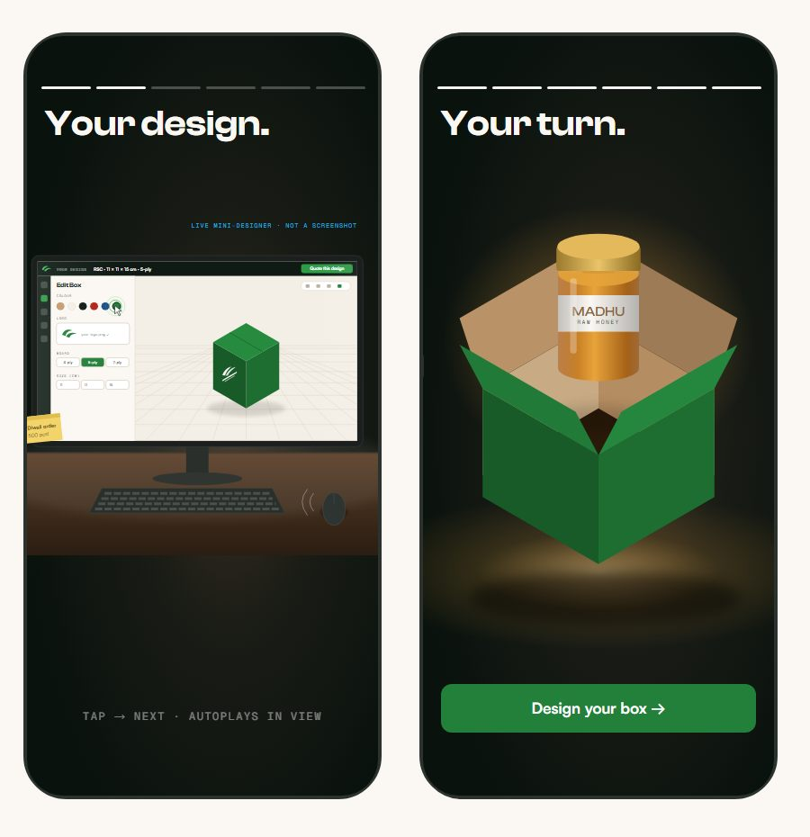

Why stories mode on phones: long pinned sections feel like the page is "stuck" on a phone and fight thumb scrolling. A story card is a format every phone user already knows, so it keeps the emotion without hijacking scroll.

---

## 8. Performance budget

| Item | Budget |
|---|---|
| Effect on LCP / first screen | **None**: the section is below the fold, and its code and canvas load lazily |
| Extra JS (gzip), on top of the three/R3F chunk the hero already loads | ≤ 60 KB |
| Extra assets | ≤ 150 KB (map path, label textures drawn at runtime, no models, no HDRI) |
| Fallback stills | 7 × ~40 KB WebP, loaded only by tiers that use them |
| Frame rate | 60 fps on desktop; ≥ 30 fps on a mid-range Android in stories mode |
| Layout shift | 0: fixed-height stage, reserved before mount |
| WebGL contexts | Only one awake at a time: the hero canvas pauses when off screen, and the story canvas mounts near view |
| Monitor screen (scene 3) | `RenderTexture` at ≤ 1024 × 576, rendered only while scenes 3a–3c are on screen and only when something changes; medium tier uses a texture redrawn per click instead of a live second scene |
| Memory | Dispose everything on unmount (the rig already has `dispose()`) |

Checked on: Chrome desktop, a throttled 4× CPU / Fast 3G profile, a real mid-range Android, Safari iOS.

---

## 9. Accessibility, SEO and analytics

- **Screen readers:** the section is `aria-labelledby` a hidden H2 *"From your product to your doorstep"*. A hidden ordered list gives the 9 steps in one short line each. The canvas is `aria-hidden`.
- **Skip:** a "Skip the story ↓" link (like the hero's "Skip animation"), and the progress rail is made of keyboard-focusable buttons.
- **Auto-moving content** (phone stories mode) has a visible pause button and stops when out of view (WCAG 2.2.2).
- **Reduced motion:** stills + cross-fades, never camera motion.
- **SEO:** no change to the page's headings order or the H1; the hidden step list gives crawlers the meaning.
- **Analytics** (existing `useEventTracker`): `story_scene_view` (scene 1, 2, 3a–3c, 4–7, tier), `story_complete`, `story_cta_click` (design / quote), `story_skip`. This shows how far people get and whether the story beats the old flow at sending people to the designer.

---

## 10. Phases and effort

Each phase ends with a preview link and screenshots from `story-beats.mjs` for the owner.

| Phase | What | Effort | Owner check |
|---|---|---|---|
| **A. Blockout** | Grey shapes only: pin, camera path, timing of the 9 scenes, words, rail | 2 days | **"Does the story feel right?"** Change order or timing here, while it is cheap |
| **B. Real objects 1** | `BoxRig` in the scene, jar, materials, lighting, scenes 1–2 | 2 days | Look and feel of the hero objects |
| **B2. The desk** | Desk props, monitor `RenderTexture`, the live mini-designer, cursor + desk mouse, the reveal pull-back and the "out of the screen" moment (scenes 3a–3c) | 3–4 days | The design-and-order moment |
| **C. Real objects 2** | Pallet + ×500, map + truck, doorstep, unboxing glow, CTA (scenes 4–7) | 3 days | Full desktop film |
| **D. Phones and fallbacks** | Stories mode, stills export, reduced motion, kill switch, a11y | 2 days | Phone review |
| **E. QA and launch** | Perf pass, `beats.ts` tests, site-audit before/after, analytics | 1–2 days | Go-live |
| F. Optional extras | Use the visitor's saved design in scene 3; a product picker in scene 1 (jar / shoe / phone); stretch-film wrap | 2–3 days | Later, based on analytics |

**Total for A–E: about 14–15 working days** (the desk scenes add about 3 days to the first estimate).

---

## 11. Risks

| Risk | Mitigation |
|---|---|
| The mini-designer on the monitor drifts out of date when the real tool changes | It reads colours and specs from the tool's own data; the layout check is part of the story QA job (§6.4) |
| A long pinned section tires people | 650vh max, a hold on each scene, a clickable rail, a "Skip the story" link; phones are not pinned |
| Slow on mid-range phones | Tiering (§7), render on demand, instancing, no post-processing below the high tier, stills fallback |
| Story repeats S6/S7 | Accepted for now; trimming them is decision D4 |
| The jar looks like a real brand | The label is a made-up, generic name (*MADHU raw honey*). No real brand marks (image policy). VERIFY-LATER[STORY-01]: the owner may prefer a real client's product, with permission |
| "Delivered across India" claim | Map wording follows `FACTS`; VERIFY-LATER[STORY-02] |
| Two 3D sections on one page feel like too much | The top hero is short and calm; the story is the one big moment. If needed, the top hero can switch to its poster image while the story is in view |

---

## 12. References

About 30 references were checked live on 17 Nov 2026, and every link loaded at the time (except where marked). The ★ items are the top 8 models for this section. The screenshots were taken headlessly for **internal reference only**. They belong to their owners and must never be used on the site.

### 12.1 Screenshots

> These screenshots are kept on the design machine only (`story-hero/refs/` is in `.gitignore`), because this repository is public and the images belong to their owners. On GitHub the image links below will not resolve.

| | |
|---|---|
| **★ Oryzo (Lusion), Awwwards Site of the Month, Apr 2026**: [oryzo.ai](https://oryzo.ai/) <br>One small physical product in a real, lived-in setting, with measurement lines drawn around it. **Our scene 1 takes this idea.** Their rule: "realistic image, product at the centre, seamless transitions" ([write-up](https://blog.lusion.co/oryzo-bts-part-3-7-website-ux-ui-and-illustrations)). |  |
| **★ Apple AirPods Pro**: [apple.com/airpods-pro](https://www.apple.com/airpods-pro/) <br>One object, moving with scroll, almost no words. Proof that the picture can carry the page. |  |
| **★ Vizcom**: [vizcom.com](https://www.vizcom.com/) ([motion write-up](https://webflow.com/blog/vizcom-offbrand-homepage-motion)) <br>A sketch on screen becomes a real object in a real room. **This is our arc**: designed on screen → a real box at a real door. Concept only, not their imagery. |  |
| **★ pmndrs T-shirt configurator**: [demo](https://pmndrs.github.io/examples/demos/t-shirt-configurator) <br>Live recolour plus a logo decal on a 3D product, in R3F (our stack). **The model for scene 3**, where the cursor recolours and stamps the box. |  |
| **★ Bearplus "cargo journey"**: [case page](https://contra.com/p/ZWYogNQq-this-is-the-centrepiece-of) <br>One piece of cargo through four freight stages with no visible cut: "it reads as one trip". **The model for our continuity**: one box, never cut away from. |  |
| **Explore Primland**: [explore.ownprimland.com](https://explore.ownprimland.com/) <br>The camera flies over a 3D map as you scroll. Mood reference for scene 5 (the route). |  |

### 12.2 Technique links (not captured: Cloudflare check or blank in headless mode)

| Reference | Why it matters |
|---|---|
| ★ **Codrops: on-scroll folding cardboard box** ([article](https://tympanus.net/codrops/2022/12/13/how-to-code-an-on-scroll-folding-3d-cardboard-box-animation-with-three-js-and-gsap/), [demo](https://tympanus.net/Tutorials/OnScrollFoldingCardboardBox/), [repo](https://github.com/uuuulala/Threejs-folding-cardboard-box-tutorial)) | A dieline folds into a box on scroll, with real flutes at the cut edges. Our `BoxRig` already does more; this confirms the scene 2 idea |
| ★ **pmndrs: GLTF animations tied to scroll** ([demo](https://pmndrs.github.io/examples/demos/gltf-animations-tied-to-scroll)) | Scrubbing baked animation on scroll in R3F; the plan B if a scene ever needs a Blender-made animation |
| ★ **Codrops OPTIKKA** ([article](https://tympanus.net/codrops/2025/10/16/creating-smooth-scroll-synchronized-animation-for-optikka-from-html5-video-to-frame-sequences/)) | Why scroll-scrubbed video stutters, and how to do frame sequences properly (if ever used) |
| Codrops: cinematic 3D scroll with GSAP ([article](https://tympanus.net/codrops/2025/11/19/how-to-build-cinematic-3d-scroll-experiences-with-gsap/), MIT [repo](https://github.com/JosephASG/codrops-cinematic-scroll-animations)) | One pinned timeline with camera "shots": the structure of §6.5 |
| Codrops: Blender camera path → three.js ([article](https://tympanus.net/codrops/2026/07/07/building-a-scroll-driven-3d-gallery-using-a-blender-camera-path-with-three-js-and-gsap/)) | Authoring the camera path visually |
| Codrops: scroll-driven SVG map ([article](https://tympanus.net/codrops/2026/05/21/creating-scroll-driven-svg-map-animations-with-gsap/)) | Route that draws itself with a rider: scene 5, and the low-tier still |
| Codrops: Trionn, GSAP + three.js + Lenis together ([article](https://tympanus.net/codrops/2026/07/15/the-architecture-behind-trionn-coordinating-gsap-three-js-lenis-and-web-audio/)) | Our exact stack; `gsap.matchMedia()` for separate phone logic |
| pmndrs Magic Box ([demo](https://pmndrs.github.io/examples/demos/magic-box)) | "A world inside the box": a possible richer unboxing for scene 7 |
| drei [ContactShadows](https://drei.docs.pmnd.rs/staging/contact-shadows), [baked soft shadows](https://pmndrs.github.io/examples/demos/baking-soft-shadows) | Making objects feel physical cheaply |
| Framer "Truckify" ([component](https://www.framer.com/marketplace/components/interactive-button/)) | Choreography idea for the truck loading in scene 5 |

### 12.3 Galleries and other packaging sites

- Awwwards collections: [Storytelling scroll](https://www.awwwards.com/inspiration/storytelling-scroll), [Paper + Land product header](https://www.awwwards.com/inspiration/scrolling-product-header-animation-paper-land), [Der Baukasten](https://www.awwwards.com/inspiration/on-scroll-3d-animation-der-baukasten) ("printed, something you could hold in your hand"), [More Nutrition 3D product](https://www.awwwards.com/inspiration/3d-product-animation-more-nutrition), [Unikorns 3D sequence](https://www.awwwards.com/inspiration/3d-sequence-scroll-unikorns-website).
- Framer: [Storytelling Hero](https://www.framer.com/marketplace/components/storytelling-hero/) (hero → reveal → rotate → benefits pattern).
- **Competitors** (checked: [Packhelp](https://packhelp.com/), [Packlane](https://www.packlane.com/), [Pacdora](https://www.pacdora.com/), [noissue](https://noissue.co/), [Smurfit Westrock](https://www.smurfitwestrock.com/), [DS Smith](https://www.dssmith.com/)): all use static photo heroes or tool cards. **None tells a scroll story**, so this would set Vayu apart in its category.

### 12.4 Performance lessons taken from these sources

- Frame sequences: WebP, about 15–40 KB per frame, about 60–90 frames on phones, 1–2 MB phone budget, preload the first frames and then ahead of the scroll direction (OPTIKKA). This is why option B stays a fallback.
- Defer the 3D bundle and render real HTML first; compress any model with Meshopt/Draco and textures with KTX2 (utsubo 2026 roundup). Not needed, because we ship no models.
- Separate phone logic with `gsap.matchMedia()`; centralise reduced motion (Trionn).
- Scroll sync is unreliable on phones; prefer simple, non-pinned motion there (SPYLT case study). This is why phones get stories mode.

---

## 13. Decisions needed from the owner

| # | Decision | My recommendation |
|---|---|---|
| D1 | **Placement**: after Industries (between S5 and S6)? | Yes, after Industries |
| D2 | **Stage**: dark theatre (as sketched) or cream like the rest of the page? | Dark: it is what makes it feel like a moment |
| D3 | **Box colour in the story**: kraft with a one-colour green print (what most customers order), turning to brand colour only in scene 3? The sketches use solid green for clarity | Kraft + green print by default |
| D4 | Trim S6 *Dieline to dispatch* / S7 order timeline after the story ships, to cut text? | Decide after a week of analytics |
| D5 | **Product in the box**: generic honey jar (fictional label), or a real client's product (with permission), or a product picker (jar / shoe / phone)? | Generic jar now, picker in Phase F |
| D6 | Phone: **stories mode** (tap through, autoplay in view) as sketched? | Yes |
| D7 | Scene words: keep the 8 phrases in §1? | Yes, editable later in `src/content/story.ts` |
| D8 | **The person at the desk**: implied only (moving mouse, chai, sticky note, as sketched), or show hands/a figure? A figure would need an original illustration or a licensed photo, never AI | **DECIDED 17 Nov 2026: implied only.** Built that way in Phase A |
| D9 | Desk details: cutting chai + *"Diwali order, 500 pcs!"* sticky note (local, a little humour), or neutral props? | **DECIDED 17 Nov 2026: keep them, and the note follows the season** (month table in `src/content/story.ts`, `VERIFY-LATER[STORY-03]`) |

**Provisional defaults while building:** D1 after Industries, D2 dark stage, D3 kraft box turning to brand colour in the designer scene, D5 generic jar, D6 stories mode, D7 the phrases as written. All are one-line changes, so Phase A did not wait for answers. Please confirm or change D1–D3 before Phase B.

Unknown facts follow the house rule: they use what is in the code and are marked `VERIFY-LATER[STORY-nn]`. Nothing here blocks on the owner except D1–D3 before Phase B.
